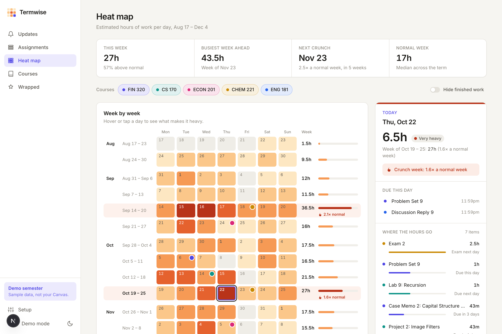
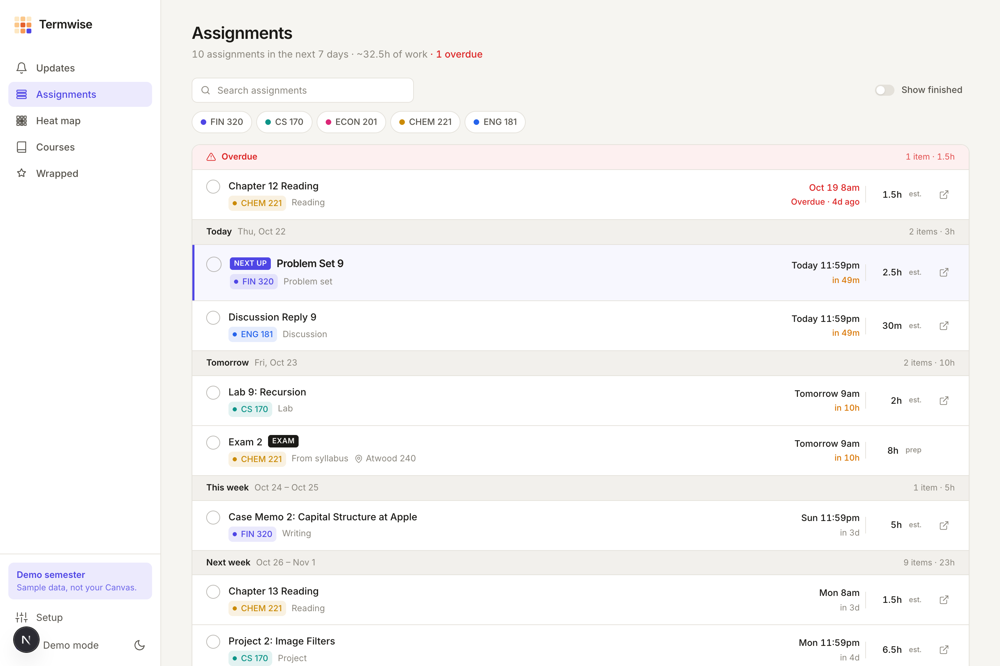
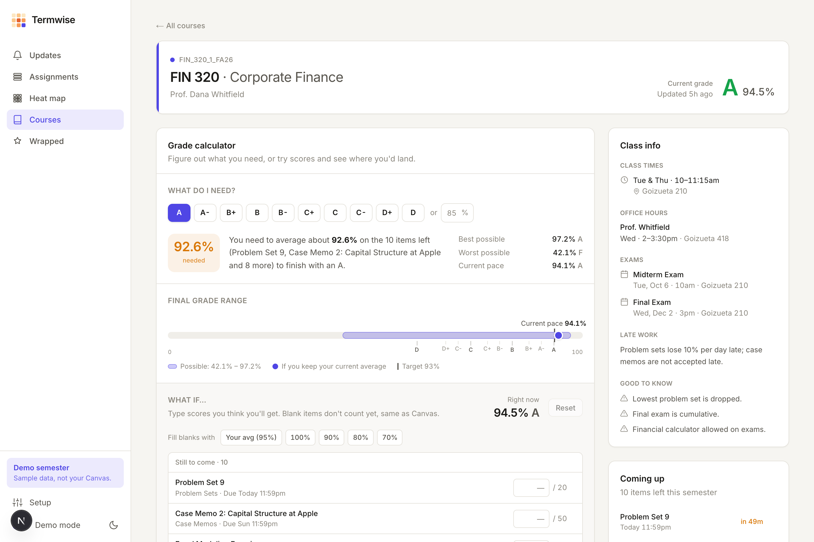
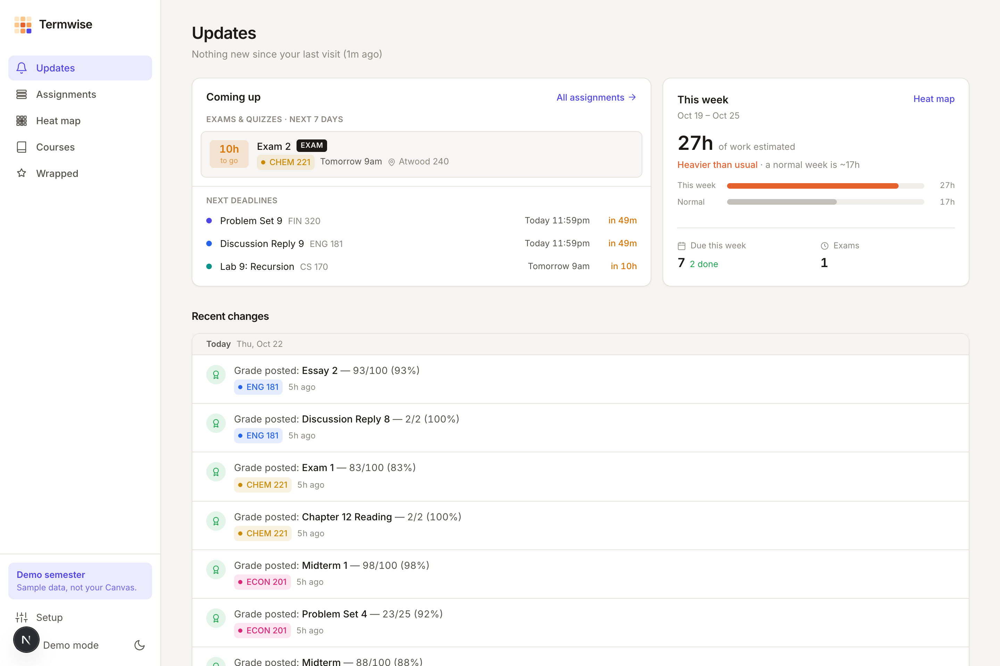
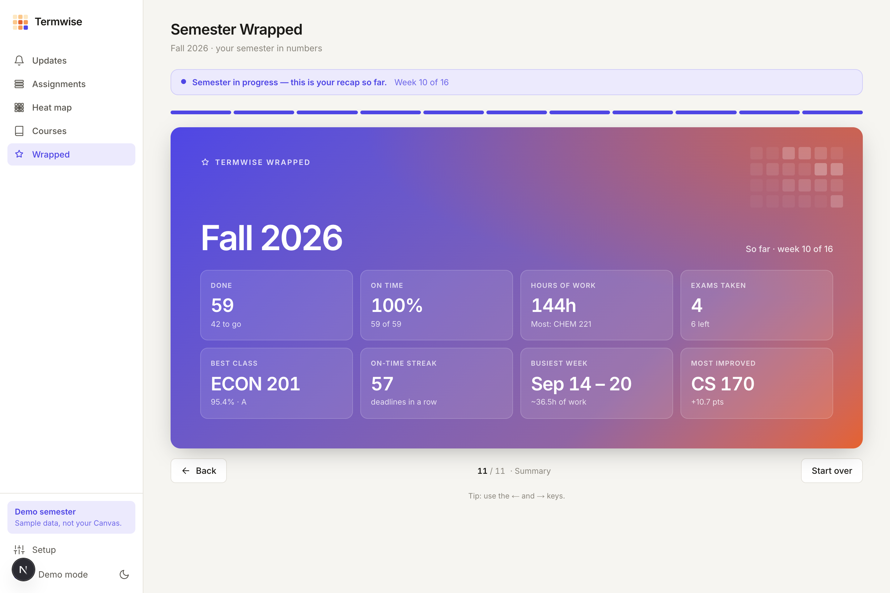

# Termwise

**Your whole semester in one place.** Termwise is a personal dashboard for school that runs on your own computer. It turns your Canvas calendar and your syllabi into one view of what's due, how heavy each week will be, where your grades stand, and what changed since you last looked.



## What it does

| View | What you get |
|---|---|
| **Updates** | Everything new since your last visit: new assignments, due dates Canvas quietly moved, renamed assignments, newly posted grades, and tests in the next 7 days. |
| **Assignments** | Every deadline, soonest first, grouped into Today / Tomorrow / This week / Later. Check things off, see estimated hours, and fix any estimate. |
| **Heat map** | The semester as a calendar colored by how many hours of work each day really holds, so crunch weeks show up weeks in advance. Click any day to see what's making it heavy. |
| **Courses** | Current grade per class, class times and office hours, a weekly timetable, and a **grade calculator**: "What do I need on the rest for an A-?" plus what-if scores. |
| **Semester Wrapped** | A Spotify-Wrapped-style recap: work finished, on-time rate, busiest week, most improved class. |

<table>
<tr>
<td></td>
<td></td>
</tr>
<tr>
<td></td>
<td></td>
</tr>
</table>

## How it gets your data (no Canvas API token)

Many schools, including Emory, don't let students create Canvas API tokens. Termwise was designed around that and only uses what every student already has:

1. **The Canvas Calendar Feed.** A private link Canvas gives every student (Calendar → Calendar Feed). It lists every assignment and due date. Termwise re-reads it every time you open the app and compares it with the last copy to find changes.
2. **Your syllabi, uploaded once.** The Claude API reads each PDF and pulls out exam dates, grade weights, drop-lowest rules, class times and office hours. You review and fix everything before it's saved.
3. **Your grades, pasted in.** Copy a course's Canvas Grades page and paste it; Claude turns it into scores, and Termwise notices which grades are new.

Everything is stored locally in a SQLite file on your computer. Only syllabus and grade text is sent to the Claude API to be read.

## How the workload estimate works

Each assignment gets an hours estimate from its type (problem set, essay, lab, reading, discussion post…), scaled by how many of that type the class has: 25 discussion posts are each quick, 3 big essays are each long. The hours are spread over the days before the deadline, heavier near the end, because that's when people actually work. Exams add study time over the five days before. A week counts as a **crunch week** when it holds two or more exams or is 1.4× a normal week. Any estimate can be overridden. All the numbers live in [`src/lib/config.ts`](src/lib/config.ts).

## Running it

Requirements: Node 22+.

```bash
npm install
npm run dev        # http://localhost:3000
npm test           # unit tests
```

Turn on **Demo mode** (bottom of the sidebar) to explore a realistic sample semester without connecting anything.

To use your own data:

1. Create an API key at [console.anthropic.com](https://console.anthropic.com) and add it to `.env.local`:
   ```
   ANTHROPIC_API_KEY=sk-ant-...
   ```
2. Open **Setup** in the app, paste your Canvas Calendar Feed link, upload your syllabi, and (optionally) paste your grades.

## Tech

Next.js 16 · React 19 · TypeScript (strict) · Tailwind CSS v4 · SQLite (`node:sqlite`) · `node-ical` · Claude API (`@anthropic-ai/sdk`, structured outputs) · Vitest.

```
src/lib/      pure logic: feed parsing, change detection, estimates, heat map, grade math (unit tested)
src/lib/ai/   syllabus and grades-paste extraction with the Claude API
src/server/   local SQLite store, feed sync, the read model pages render from
src/views/    one folder per view
src/ui/       design system
src/demo/     the sample semester
```

## License

MIT. See [LICENSE](LICENSE).
